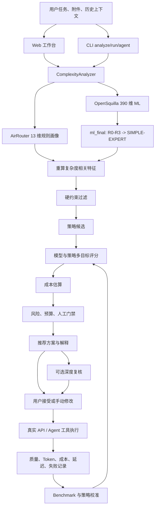
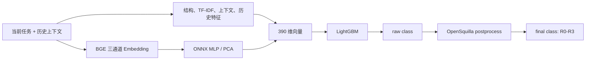
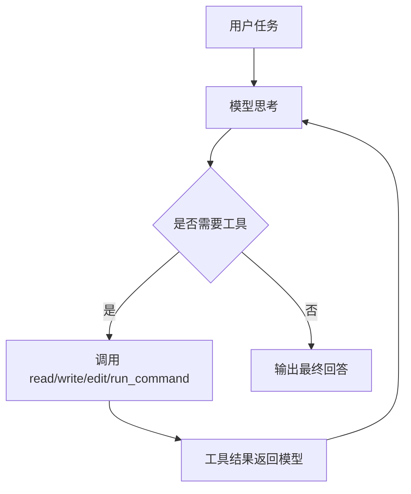

# AirRouter 项目答辩学习手册

> 这份文档不是给评委看的精简 PPT，而是给自己学习和准备答辩用的“全量底稿”。
>
> 建议先读第 1、2、16、17 章，建立主线；再按第 3 到第 15 章补技术细节；最后用第 18、19 章练习问答和演示。

---

## 0. 先记住一句话

**AirRouter 不是模型排行榜，也不只是一个聊天网页。它是一个企业 AI 任务路由与治理系统：先理解任务，再综合质量、成本、风险和可验证性推荐模型与执行策略，经用户确认后执行，并用真实评测结果持续校准路由。**

如果答辩时一紧张，只要先把这句话说清楚，后面的内容就不会跑偏。

---

## 1. 三种长度的项目介绍

### 1.1 30 秒版本

我的项目叫 AirRouter，解决的是企业里“同一个 API 网关后面有很多模型，但用户不知道该选谁”的问题。

系统会先分析任务的类型、复杂度、风险、数据敏感性、可验证性、上下文长度等特征，再过滤不满足能力和安全要求的模型，比较不同执行策略的质量、成本和延迟，最后给出可解释的推荐。用户确认以后，Web 或 CLI 才会真实执行。

为了避免路由规则靠拍脑袋，我先后做了 Level 1、Level 2、Finance、Engineering 和 Routing Ground Truth 多层 Benchmark；后来又接入 OpenSquilla 的 390 维复杂度分类器，用真实模型输出验证路由效果。最终的选择是：**OpenSquilla `ml_final` 负责增强复杂度判断，AirRouter 自己的 13 维任务画像、风险门禁、模型筛选和成本策略继续负责最终决策。**

### 1.2 2 分钟版本

企业接入多个大模型以后，真正的问题不是“哪个模型绝对最好”，而是：

1. 简单任务没必要一直用最贵模型。
2. 难任务如果用了太弱的模型，可能反复失败，反而更贵。
3. 涉及生产、权限、资金或敏感数据的任务，不能只看复杂度，还要看风险和是否需要人工批准。
4. 模型推荐不能只靠主观印象，需要有真实任务、真实输出、真实成本和可复现的评测依据。

所以我把系统拆成五段：

1. 任务画像：把自然语言任务变成结构化特征。
2. 硬约束过滤：先排除能力、上下文、敏感性和预算不满足的模型。
3. 策略生成：比较单模型、引导执行、Plan-Execute、Plan-Execute-Review。
4. 多目标评分：综合质量、成本、延迟和任务适配度选方案。
5. 治理门禁：判断能否自动执行、是否要复核或人工批准。

项目最初使用自己设计的 13 维规则画像，优点是快、可解释、离线可运行，但复杂度识别依赖关键词，泛化不够。后来我借鉴 OpenSquilla 的 390 维特征、BGE 语义 Embedding、LightGBM 和 ONNX 推理链路，把 R0-R3 映射成 SIMPLE 到 EXPERT。不过我没有直接照搬它的模型绑定，也没有让它控制最终路由，因为复杂度只是路由的一部分。

真实 Routing Ground Truth 共覆盖 90 个任务、5 个模型、450 组候选回答，并由 MiniMax-M3 完成 450 组辅助审计。结果显示 `ml_final` 的质量损失最小，而 Rules 的成本最低。因此最终不是“全部推翻规则”，而是让 `ml_final` 增强复杂度，保留 Rules 作为降级和对照，再由 AirRouter 的风险、成本和门禁完成最终决策。

产品上，我做了两种入口：普通用户使用 Web 工作台，按“分析、复核、确认、执行、追问”的流程操作；开发人员使用交互式 CLI Agent，可以读写项目文件、运行测试、多轮追问、切换模型、恢复会话和查看成本。

### 1.3 一句话回答“你做出来了什么”

我做出了一个从**任务理解、模型与策略推荐、成本估算、风险门禁，到真实执行、评测校准和结果审计**的完整 AI Router MVP，并提供 Web 与交互式 CLI 两种可演示入口。

---

## 2. 原始任务到底要求什么

### 2.1 任务来源

原始任务主要来自两个 PDF：

- `校招AI应用工程师·一个月任务清单.pdf`
- `集团 Token分析及精细化管控.pdf`

任务核心不是做一个普通聊天机器人，而是做“企业 AI 模型智能路由与 Token 治理平台”。

### 2.2 原任务的硬交付方向

可以概括为五部分：

1. **路由引擎**：根据任务特征推荐模型和执行方式。
2. **Token 与成本治理**：估算成本、分析消费、给出优化建议。
3. **评测体系**：用 Benchmark 验证任务和模型的适配关系。
4. **CLI**：支持分析、审计、优化，并能集成开发流程。
5. **Web 平台**：展示推荐、成本、审计、Benchmark 和治理配置。

### 2.3 哪些是我主动扩展的

交互式 Agent 不是 PDF 中明确要求的硬交付物。PDF 里提到 Agent/Harness 和上下文优化方向，但没有要求必须做一个 Claude Code 风格的完整 Agent。

我后来增加 `ai-router run` 和 `ai-router agent`，原因不是为了无限扩功能，而是为了证明路由结果能进入真实工程执行，而不只是停留在报告里。这是项目工业价值的延伸：

```text
以前：推荐 deepseek-v4-pro，然后结束
后来：推荐 deepseek-v4-pro，用户确认，Agent 读文件、改代码、跑测试、报告成本
```

答辩时要诚实说：**Agent 是建立在 Router 之上的增强演示，不是原任务唯一主线。主线始终是路由与治理。**

---

## 3. 项目一开始面对的核心矛盾

### 3.1 不是“越强越好”

如果所有任务都用最强模型，质量可能较稳，但企业成本不可控。

如果所有任务都用最便宜模型，成本低，但复杂任务、工程任务和高风险任务容易失败。

所以问题不是找到一个永久冠军，而是回答：

> 对当前这个任务，满足质量与安全要求的最便宜模型是谁？应该单模型执行，还是规划、执行、复核？是否必须由人确认？

### 3.2 复杂度不是唯一标准

“简单任务用便宜模型，复杂任务用贵模型”只是口号，无法直接落地。

例如：

| 任务 | 复杂度 | 风险 | 可验证性 | 正确处理方式 |
|---|---|---|---|---|
| 汇总一张表格 | 低 | 低 | 高 | 便宜模型，程序校验 |
| 删除生产数据库记录 | 低 | 极高 | 高 | 不能因为简单就自动执行，必须人工批准 |
| 修复多文件代码并跑单测 | 高 | 中 | 高 | 强模型或 Plan-Execute，测试验证 |
| 写一段品牌战略建议 | 中 | 中 | 低 | 需要更强推理和人工判断 |
| 需求描述模糊 | 未知 | 未知 | 低 | 先澄清，不应直接选模型执行 |

因此最终使用四个通用判断维度：

- `complexity`：任务本身有多少步骤、多少依赖和推理。
- `risk`：做错以后影响多大，是否可逆。
- `verifiability`：结果能否被测试、程序或规则明确验证。
- `uncertainty`：输入是否完整、目标是否明确、口径是否冲突。

### 3.3 执行前不可能 100% 知道难度

这是答辩里很重要的一点。

系统在执行前只能根据任务文本、附件、历史上下文和已有数据做保守初判，不能预知模型一定会不会答对。因此路由必须是一个闭环，而不是一次分类：

```text
任务画像
  -> 初始推荐
  -> 用户确认或澄清
  -> 模型执行
  -> 程序/规则/Judge/人工评价
  -> 记录质量与成本
  -> 更新后续策略
```

---

## 4. 项目是怎么一步一步做出来的

这一章是答辩故事的主干。讲的时候不要按文件名念，要讲“问题、方法、实验、结论”。

### 4.1 第一阶段：先搭可配置的骨架

最先做的不是 ML，而是把模型、价格、预算和规则从代码中抽出来。

主要文件：

- `data/models.yaml`：模型能力、价格、上下文窗口、Tier。
- `data/routing_rules.yaml`：路由规则和阈值。
- `data/budgets.yaml`：预算与治理限制。
- `src/airouter/config.py`：统一加载配置。
- `src/airouter/models/`：枚举、Schema、数据库模型。

为什么先这样做：

1. 模型价格和能力会变，不能硬编码在算法里。
2. Benchmark 必须记录当时使用的配置，否则无法复现。
3. 后续换模型、调阈值、加部门策略时，不应该重写引擎。

这一阶段解决的是“系统能不能长期演进”，还没有解决“推荐准不准”。

### 4.2 第二阶段：设计 13 维任务画像

我先做了一个可解释、零 API 成本的规则分析器，把自然语言任务转换为 `TaskFeatures`。

13 个维度是：

| 序号 | 字段 | 大白话解释 | 对路由的影响 |
|---|---|---|---|
| 1 | `category` | 这是代码、文档、数据、聊天还是分析任务 | 不同模型擅长领域不同 |
| 2 | `complexity` | 单步还是多步，是否要跨文件和深入推理 | 决定基础模型档位 |
| 3 | `risk_level` | 做错以后影响多大 | 决定是否升级、复核或人工批准 |
| 4 | `sensitivity` | 是否含真实个人、财务、权限等敏感数据 | 过滤不能处理敏感数据的模型 |
| 5 | `verifiability` | 能否用测试、规则或程序验证 | 决定可否让便宜模型先做 |
| 6 | `output_strictness` | 输出格式是否严格，例如 JSON、SQL、Patch | 决定结构化能力要求 |
| 7 | `context_requirement` | 需要多少历史、附件或多文件上下文 | 决定上下文窗口要求 |
| 8 | `reasoning_intensity` | 需要多少推理和规划 | 决定模型能力与策略 |
| 9 | `estimated_input_tokens` | 预计输入多长 | 用于成本和窗口估算 |
| 10 | `estimated_output_tokens` | 预计输出多长 | 用于成本和截断风险估算 |
| 11 | `subtasks` | 能否拆成若干步骤 | 决定是否适合 Plan-Execute |
| 12 | `required_capabilities` | 必须具备的能力 | 硬过滤，例如 vision、judge |
| 13 | `preferred_capabilities` | 有最好、没有也能做的能力 | 用于候选模型排序 |

实现位置：

- `src/airouter/models/schemas.py`：`TaskFeatures` 数据结构。
- `src/airouter/engine/router/analyzer.py`：规则特征提取。

#### 13 维是怎么提取的

早期主要采用：

1. 加权关键词匹配。
2. 正则和结构信号，例如代码块、文件名、SQL、JSON。
3. 任务类型相关规则。
4. 风险与敏感性上下文组合判断。
5. 输入长度和任务结构估算。

举例：

```text
“帮我修复 auth.py 的 SQL 注入漏洞，并运行测试验证”
```

规则分析可能得到：

```text
category = CODE_FIX
complexity = MODERATE
risk = HIGH
verifiability = HIGH
output_strictness = MEDIUM
reasoning = HIGH
subtasks = [定位漏洞, 修改代码, 运行测试]
required_capabilities = {code, tool_use}
```

#### 为什么一开始不用大模型分析任务

因为任务分析本身如果每次都先调用大模型，会带来：

1. 额外成本。
2. 更高延迟。
3. 大模型判断也不稳定。
4. 路由器会陷入“为了选模型，先选一个模型”的循环。

规则分析器几十到一百多毫秒即可本地完成，适合做基础画像和降级路径。

#### 13 维的优点和缺点

优点：

- 快，完全本地。
- 可解释，能说出命中了什么信号。
- 不依赖外部 API。
- 容易做硬约束和审计。

缺点：

- 关键词总会漏。
- 同一句话换个表达可能分类不同。
- 对语义复杂但没有明显关键词的任务识别较弱。
- 复杂度容易受人工规则偏见影响。

这就是后来接 OpenSquilla 的直接原因。

### 4.3 第三阶段：完成五段式 Router

完成任务画像后，不能直接写成 `SIMPLE -> flash`。真正的 Router 分为五段。


主要文件：

- `src/airouter/engine/router/router.py`
- `src/airouter/engine/router/analyzer.py`
- `src/airouter/engine/router/classifier.py`
- `src/airouter/engine/router/selector.py`
- `src/airouter/engine/router/estimator.py`
- `src/airouter/engine/router/gate.py`

#### 第 1 段：任务画像

产出刚才讲的 13 维特征。

#### 第 2 段：硬约束过滤

先排除不可能满足要求的模型，例如：

- 不支持图片，却收到图片附件。
- 上下文窗口装不下输入。
- 缺少代码、工具调用或 Judge 能力。
- 数据敏感性策略不允许。
- 超出预算上限。

硬约束和评分的区别：

- 硬约束是“不满足就不能选”。
- 评分是“都能选时谁更合适”。

#### 第 3 段：候选策略

系统不只选模型，也选执行方式：

| 策略 | 含义 | 适用任务 |
|---|---|---|
| `SINGLE_MODEL` | 一个模型直接完成 | 边界清楚、单步或普通任务 |
| `GUIDED_EXECUTE` | 给模型更明确的约束或步骤 | 中等复杂、需要格式约束 |
| `PLAN_EXECUTE` | 强模型规划，另一模型执行 | 可拆解、多步骤、输出较长 |
| `PLAN_EXECUTE_REVIEW` | 规划、执行后再复核 | 高风险、低可验证或重要任务 |

一个常见误区是“复杂任务一定 Plan-Execute”。实际不是。

如果强模型单次完成只花 ¥0.02，而规划加执行要 ¥0.05，Plan-Execute 反而更贵。只有任务可拆解、局部上下文能减少、步骤明确且质量收益足够时，它才值得使用。

#### 第 4 段：多目标评分

候选方案会综合比较：

- 能力适配度
- 历史质量
- 成本
- 延迟
- 风险
- 任务类型偏好

不同任务权重不同。例如：

- 普通摘要更看成本和延迟。
- 安全审查更看质量和风险。
- 严格 JSON 更看结构化输出能力。

#### 第 5 段：成本估算与治理门禁

成本估算使用：

```text
输入成本 = 输入 Token / 1,000,000 × 输入单价
输出成本 = 输出 Token / 1,000,000 × 输出单价
总成本 = 输入成本 + 输出成本 + 多阶段调用成本
```

价格来源以 `data/models.yaml` 为准，并用真实 CCH 用量 CSV 对账。项目曾经发现“总成本大致对，但单模型价格排序错”的问题，因此后续明确：**模型价格不能只靠官网或手工估计，最终要和后台账单核对。**

门禁负责决定：

- 自动执行
- 先澄清
- 执行后复核
- 人工批准
- 拒绝或降级

### 4.4 第四阶段：增加审计和上下文优化

在路由以后，项目继续完成：

- `ai-router audit`：分析历史消费和浪费模式。
- `ai-router optimize`：给出上下文裁剪、去重、压缩和分层建议。
- SQLite 审计记录：保存模型、任务类型、Token、成本和决策。

主要位置：

- `src/airouter/engine/audit/`
- `src/airouter/engine/optimize/`
- `src/airouter/engine/context/`

为什么要做：路由只解决“这次选谁”，审计和优化解决“长期为什么这么贵、哪里能省”。

### 4.5 第五阶段：开始 Benchmark，不再靠感觉调路由

做到这里，系统能运行，但还不能证明推荐正确。

因此后面的工作重点从“增加功能”转成“建立可信评测”。完整评测历程见第 9 章。

### 4.6 第六阶段：用 Finance 做企业业务样板

Finance Benchmark 并不是把项目做成财务专用系统，而是选择一个可验证、风险清楚、业务价值高的领域，验证整条链路：

```text
真实业务任务
 -> 多模型回答
 -> 程序与规则评分
 -> Judge 辅助审计
 -> 成本对账
 -> 错误归因
 -> 路由策略更新
```

财务场景覆盖：

- 表格计算
- 报销审核
- 三单匹配
- 银行对账
- 预算分析
- 制度问答

这一步最重要的收获不是 qwen3.7-plus 排第一，而是发现：

1. 评分器也可能错。
2. 题目口径可能有歧义。
3. 附件没有真正注入 Prompt 会让结果失真。
4. 规则适合金额、字段、Schema 等硬真值。
5. Judge 适合解释、证据和幻觉审计，但不能当标准答案。

### 4.7 第七阶段：从 Finance 抽象到 Engineering

为了证明方法可迁移，项目设计了 30 条 Engineering Benchmark：

- `CODE_FIX`
- `CODE_REVIEW`
- `LOG_ANALYSIS`
- `SQL_SAFETY`
- `CONFIG_CHANGE`
- `ANTI_HALLUCINATION`

重点不只是“代码写得好不好”，而是工程可控性：

- 是否遵守“只解释、不修改”。
- 是否伪造文件、日志或测试结果。
- 是否识别生产、权限、支付、删除等风险。
- 信息不足时是否先澄清。
- 是否修改无关文件。

数据文件：`data/benchmarks/engineering/engineering_cases.yaml`。

### 4.8 第八阶段：接入 OpenSquilla

规则复杂度的泛化不足已经被校准数据暴露出来。此时项目没有重新从零训练一个分类器，而是复用开源项目 OpenSquilla 已训练好的复杂度推理能力。

这一阶段不是“把 13 维换成 390 维”，而是：

```text
AirRouter 13 维任务画像继续生成
                +
OpenSquilla 390 维特征专门增强 complexity
                +
AirRouter 根据新复杂度重算相关资源特征
                +
AirRouter 自己完成模型、策略、成本和门禁决策
```

详细区别见第 7、8 章。

### 4.9 第九阶段：建立 Routing Ground Truth

最初用人工标签判断 SIMPLE、MODERATE、COMPLEX、EXPERT，仍然有主观性。

后来把“路由真值”重新定义成：

> 在真实回答能够达标的模型中，最便宜的那个模型档位，才是这道题的路由真值。

这一步让项目从“分类器和人工标签像不像”，走向“路由器最终选得值不值”。

### 4.10 第十阶段：做面向普通用户的 Web

最早的 Web 是治理后台，普通用户会看到 Benchmark pair、Judge 覆盖、复杂度枚举等工程术语，使用门槛太高。

后来改成：

```text
输入任务
 -> 本地分析
 -> 看推荐模型、处理方式、成本和原因
 -> 可选深度复核
 -> 用户接受或修改
 -> 真实执行
 -> 继续追问
```

这一步把“后端能力”翻译成了“用户能理解的产品”。

### 4.11 第十一阶段：做开发者 CLI Agent

普通 CLI `analyze` 只能推荐，`run` 是一次性执行。为了让开发人员真正使用，后来增加交互式 `agent`：

- 多轮对话
- 读写项目文件
- 执行安全命令和测试
- 模型切换
- 会话保存与恢复
- 上下文压缩
- 成本上限
- 用户授权危险或越界命令

这让项目形成两种体验：

- Web：给普通业务用户。
- CLI Agent：给开发人员。

---

## 5. 当前系统完整架构



### 5.1 技术栈

| 层 | 技术 | 选择原因 |
|---|---|---|
| 语言 | Python 3.11+ | AI、数据、CLI、Web 可以统一开发 |
| 配置 | YAML + Pydantic | 配置可审计，Schema 可校验 |
| CLI | Typer + Rich | 命令定义清楚，终端展示友好 |
| Web | Streamlit | 4 周 MVP 可快速复用 Python 引擎 |
| 模型 API | OpenAI-compatible | 公司网关 URL 统一，模型和 Key 可配置 |
| 审计 | SQLAlchemy + SQLite | MVP 本地可运行，保留迁移数据库空间 |
| ML 推理 | LightGBM + ONNX + BGE | 复用 OpenSquilla 已训练 bundle |
| 测试 | pytest | 单元、集成和 Benchmark 链路验证 |
| 质量 | ruff + mypy | 代码规范和类型检查 |

### 5.2 当前模型池

以 `data/models.yaml` 为准，当前主要模型包括：

| Tier | 模型 | 主要定位 |
|---|---|---|
| Tier 1 | `qwen3.7-max` | 质量基线、复杂任务、上下文压缩 |
| Tier 1 | `deepseek-v4-pro` | 高质量与性价比 |
| Tier 1 | `kimi-k2.6` | 候选强模型，价格仍需继续校准 |
| Tier 2 | `qwen3.7-plus` | 均衡模型，当前图片/多模态模型 |
| Tier 2 | `MiniMax-M3` | 深度复核和 Judge |
| Tier 2 | `glm-5.1` | 通用候选模型 |
| Tier 3 | `deepseek-v4-flash` | 低成本、快速任务 |

`claude-sonnet-4-6` 已从当前可选模型中移除，因为公司现有 API 不可用，不能让前端和 Router 推荐一个无法执行的模型。

---

## 6. 13 维规则到底还有没有用

有用，而且不能删。

### 6.1 OpenSquilla 没有替代全部任务画像

OpenSquilla 主要输出复杂度等级，而最终路由还需要：

- 任务类型
- 风险
- 敏感性
- 可验证性
- 输出格式要求
- 上下文规模
- Token 估算
- 子任务
- 必需能力

所以 390 维不是“比 13 维大，因此整个替换”。两者解决的问题不同。

### 6.2 当前实际流程

1. AirRouter 规则分析器先生成完整 13 维画像。
2. `mode=opensquilla` 时加载 OpenSquilla，得到 `final_route_class`。
3. 将 R0-R3 映射为 SIMPLE-EXPERT。
4. 如果 ML 复杂度和规则复杂度不同，重新计算受复杂度影响的上下文、Token、推理强度、子任务和能力字段。
5. 再进入 Selector、Estimator 和 Gate。

### 6.3 规则的三个保留价值

1. **降级**：ML bundle 缺失或加载失败时，系统仍可运行。
2. **解释与对照**：可以比较 `rule_complexity` 和 `ml_final`，发现模型漂移。
3. **硬信号**：权限、生产删除、附件类型、上下文长度等确定性事实仍应由规则和程序处理。

### 6.4 当前各入口使用什么模式

| 入口 | 当前模式 | 说明 |
|---|---|---|
| `ai-router analyze` | 默认 `opensquilla` | 使用 `ml_final`，可显式切 `--mode rules` 做对照 |
| `ai-router run` | 强制 `opensquilla` | 一次性 Agent 执行 |
| `ai-router agent` | 强制 `opensquilla` | 交互式 REPL 每轮重新分析 |
| Web 普通用户主流程 | `opensquilla` | 本地分析后给推荐 |
| 管理员高级分析 | rules/shadow/hybrid 可选 | 用于诊断和比较 |
| ML 不可用 | 回退 Rules | 会保留诊断原因，不让流程崩溃 |

---

## 7. OpenSquilla 的 390 维到底是什么

### 7.1 来源和许可证

| 项目 | 内容 |
|---|---|
| 来源 | `https://github.com/opensquilla/opensquilla` |
| 固定 Commit | `5409a22a5205846a6f9998e2d361cf286d8caa8d` |
| 模型版本 | v4.2 phase 3 inference |
| 许可证 | Apache License 2.0 |
| Bundle | `opensquilla/src/opensquilla/squilla_router/models/v4.2_phase3_inference/` |

来源追溯见：`docs/opensquilla-router-provenance.md`。

### 7.2 390 维不是 390 个手写关键词

390 维包含多类信号，核心组成是：

| 特征组 | 维度 | 作用 |
|---|---:|---|
| HC 手工与结构特征 | 51 | 长度、代码、格式、任务结构等 |
| TF-IDF | 102 | 词语分布和任务表达 |
| Context | 10 | 上下文规模与结构 |
| History | 16 | 历史对话信号 |
| PCA-BGE | 192 | 语义 Embedding 降维结果 |
| Assistant | 12 | 助手历史信号 |
| Continuation | 2 | 是否为延续任务 |
| Reasoning | 5 | 推理需求信号 |
| **合计** | **390** | 输入 LightGBM 分类器 |

其中 BGE 原始语义部分是三通道：

- 当前用户消息
- 历史用户消息
- 上一轮助手消息

每个通道原始 512 维，合计 1536 维，经 ONNX MLP 和 PCA 等预处理后形成最终输入的一部分。

### 7.3 推理链路



### 7.4 R0-R3 怎么映射

| OpenSquilla | AirRouter | 一般模型档位启发 |
|---|---|---|
| R0 | SIMPLE | Tier 3 |
| R1 | MODERATE | Tier 2 / Tier 3 |
| R2 | COMPLEX | Tier 1 / Tier 2 |
| R3 | EXPERT | Tier 1 |

注意：这只是复杂度映射，不是最终模型绑定。R2 不等于永远选某个固定模型。

### 7.5 AirRouter 借鉴了什么

直接复用或适配了：

1. 已训练的 LightGBM 主模型和辅助模型。
2. BGE ONNX Embedding 模型。
3. TF-IDF、PCA、Scaler 等特征资产。
4. 390 维特征提取与推理运行时。
5. R0-R3 原始和后处理结果。

AirRouter 自己补充了：

1. R0-R3 到自身复杂度枚举的映射。
2. `rules`、`shadow`、`opensquilla`、`hybrid` 四种运行模式。
3. bundle 哈希、文件大小、源码树、symlink 和意外二进制校验。
4. ML 失败降级与诊断元数据。
5. 复杂度改变后的相关特征重算。
6. 与模型能力、成本、风险和 Gate 的组合。
7. 校准、Ground Truth、策略回放和报告。

### 7.6 没有照搬什么

没有照搬：

- OpenSquilla 自带的模型绑定。
- 它的最终生产路由策略。
- 它的价格表。
- “R0 固定模型 A、R1 固定模型 B”的映射。
- 重新训练流程。

原因是 AirRouter 的模型池、API 网关、价格、业务风险和可用能力都不同。直接照搬模型绑定会产生领域错位。

### 7.7 为什么不能说“390 维肯定比 13 维好”

维度多不等于一定好，必须同时满足：

1. 推理时的预处理和训练时一致。
2. 输入分布和训练数据不能差太远。
3. 标签定义要一致。
4. 最终指标要测任务质量和成本，而不只是标签准确率。

所以项目不是因为“390 大于 13”就采用，而是先接入真实 bundle，再用 70 条校准和 450 组真实结果验证。

---

## 8. OpenSquilla 四种模式怎么讲

| 模式 | 是否加载 ML | 最终复杂度 | 用途 |
|---|---|---|---|
| `rules` | 否 | 规则复杂度 | 降级、基线、对照 |
| `shadow` | 是 | 仍用规则；记录 ML 判断 | 无行为影响的观测 |
| `opensquilla` | 是 | 使用 `final_route_class`，可升可降 | 当前用户入口默认 |
| `hybrid` | 是 | 使用 raw class，只允许升级 | 保守增强实验 |

### 8.1 为什么最终用户入口选择 `opensquilla/ml_final`

不是因为它在人工复杂度标签上“准确率最高”。70 条标签校准中，它的标签 Accuracy 反而只有 45.7%。

采用它的原因是后续 Ground Truth 评价目标发生了升级：不再问“和人工写的复杂度一样吗”，而是问“最终是否选择到能完成任务的低成本模型”。在这个更接近业务结果的指标上，`ml_final` 的质量表现最好，Holdout `quality_regret=0.068`。

### 8.2 为什么还保留 Rules

Rules 在 Dev 集上成本后悔值最低，而且是可靠降级路径。因此当前策略不是删除 Rules，而是：

```text
正常用户入口：ml_final 增强复杂度
ML 加载失败：Rules 降级
管理员页面：Rules / Shadow / Hybrid 对照诊断
硬风险与确定性约束：仍由 AirRouter 规则和程序负责
```

---

## 9. Benchmark 是怎么一层层建立起来的

### 9.1 为什么不能只跑一次测试

路由系统至少要回答四个问题：

1. 路由逻辑有没有明显错误？
2. 不同模型真实质量怎样？
3. 评分器本身是否可信？
4. Router 最终选择是否兼顾质量和成本？

一个 Benchmark 无法同时回答全部问题，所以项目采用逐层验证。

### 9.2 Level 1：先测路由机械逻辑

规模：40 条离线用例。

位置：`data/benchmarks/level1/router_cases.yaml`。

目的：

- 类别和规则是否按预期触发。
- 风险门禁是否生效。
- 预算和候选池是否正确。
- 不调用真实 API，快速回归。

它验证的是“代码是否按规则工作”，不是“规则是否代表真实世界”。这是后来非常重要的反思。

### 9.3 Level 2：真实模型质量比较

正式评测由 30 个任务、5 个模型组成：

- 候选模型回答：150 次。
- Absolute Judge：300 次。
- Pairwise Judge：600 次。
- 合计：1050/1050 成功。

三层评分：

| 层 | 方法 | 作用 |
|---|---|---|
| Auto-score | AST、结构、关键词、格式检查 | 快速确定性基线 |
| Absolute Judge | 两个 Judge 按任务专用 rubric 独立评分 | 评价完整性、推理和解释 |
| Pairwise Judge | A/B 隐藏模型名、随机顺序盲评 | 减少模型名与位置偏见 |

主要结果：

| 模型 | Pairwise 胜率 | 30 任务成本 |
|---|---:|---:|
| deepseek-v4-flash | 20.0% | ¥0.12 |
| deepseek-v4-pro | 32.9% | ¥0.37 |
| qwen3.7-plus | 67.9% | ¥1.03 |
| glm-5.1 | 48.3% | ¥2.59 |
| qwen3.7-max | 73.8% | ¥5.67 |

结论：

1. qwen3.7-max 质量最高，但成本也最高。
2. qwen3.7-plus 是较好的质量成本平衡点。
3. flash 很便宜，但 Auto-score 会高估它，因为命中关键词不等于分析深入。
4. 单一 Judge 不可靠，必须双 Judge 和盲评交叉验证。

报告：`docs/model-selection-report.md`。

### 9.4 Finance Benchmark：验证企业业务链路

规模：

- 36 个财务案例。
- 6 类任务。
- 5 个模型。
- 180/180 真实模型调用成功。
- 总成本 ¥7.4962。

主排名第一：`qwen3.7-plus`，综合分 0.866。

MiniMax-M3 Judge：180/180 完成，只作辅助审计，不改变主排名。

模型级规则分与 Judge 分 Spearman 相关系数为 0.900，说明总体排名方向接近；但早期进一步分析发现案例级相关性约 0.288，说明具体到单题时分歧很大。

这说明：

> 模型级排名一致，不代表每道题都判断一致。规则和 Judge 都不能独立当真值。

报告：`runs/benchmarks/finance/20260610_084555/finance_report.md`。

### 9.5 Engineering Benchmark：验证工程可控性

规模：30 条 synthetic case，每类 5 条。

不仅测正确性，还测：

- `instruction_following`
- `no_hallucination`
- `evidence_quality`
- `risk_identified`
- `asks_clarification_when_needed`
- `human_approval_required`
- `no_unrelated_changes`

为什么要 synthetic fiction：避免使用真实公司代码和数据，同时能精确控制预期行为和禁止行为。

### 9.6 70 条 OpenSquilla 校准：第一次发现标签问题

校准集：Level 1 的 40 条加 Engineering 的 30 条，共 70 条。

结果：

| 策略 | 人工标签 Accuracy | 欠路由 | 过度路由 | 说明 |
|---|---:|---:|---:|---|
| Rules | 68.6% | 28.6% | 2.9% 左右 | MODERATE 大量判成 SIMPLE |
| ml_raw | 45.7% | 21.4% | 32.9% | 更保守，升级较多 |
| ml_final | 45.7% | 10.0% | 44.3% | 欠路由显著下降，但过度路由高 |
| Hybrid 0.50 | 64.3% | 17.1% | 18.6% | 成本约增加 54.8% |

另外：

- ML 推理 70/70 成功。
- Rules 把 16/28，也就是 57% 的 MODERATE 判成 SIMPLE。
- Rules 严重欠路由率 4.3%。
- ml_final 严重欠路由率降到 1.4%。

这组数据不能简单得出“OpenSquilla 比 Rules 差”，因为它比较的是人工复杂度标签，而两套系统的标签定义和训练分布并不相同。

这次实验真正告诉我们：

1. Rules 更贴合自己写的 L1 标签，所以 Accuracy 天然占优。
2. OpenSquilla 倾向保守升级，降低欠路由，但提高过度路由。
3. 复杂度标签一致率不是最终路由价值。
4. 必须用真实模型输出建立路由真值。

### 9.7 Routing Ground Truth：最终关键实验

#### 真值怎么定义

假设同一道题的结果是：

```text
flash：失败
plus：通过
pro：通过
max：通过
```

那么真值不是人工写的 “MODERATE”，而是：

```text
最便宜的通过模型 = plus 对应档位
```

然后比较各路由策略选了谁：

- 选 max：质量可以，但浪费成本。
- 选 plus：正确。
- 选 flash：欠路由。
- 要求人审但实际 plus 能做：可能过度保守。

#### 数据规模

- Dev：30 条 Engineering。
- Holdout：60 条独立通用任务。
- 合计 90 条。
- 5 个模型。
- 候选回答 450/450 成功。
- MiniMax-M3 Judge 450/450 成功。

Holdout 覆盖：

- 文档理解 8
- 表格数据 8
- 代码调试 8
- 日志运维 8
- 多轮对话 7
- 工具调用 7
- 规划 7
- 指令与反幻觉 7

#### 评分链

```text
JSON/结构解析
 -> 确定性检查
 -> 程序测试或沙箱
 -> 规则维度评分
 -> 盲审 Judge
 -> 人工抽检
 -> 是否通过
 -> 最便宜通过模型形成 Oracle
```

这里的 Oracle 不是数据库，而是“这道题路由应该选什么”的基准答案。

#### 关键结果

| 指标 | 结果 |
|---|---:|
| 候选模型调用 | 450/450 成功 |
| Judge | 450/450 成功 |
| 总体通过率 | 67.3%，303/450 |
| Dev 通过率 | 50.7% |
| Holdout 通过率 | 75.7% |
| no-passing case | 16 个 |
| Judge 净救活 | 13 pair |
| Oracle 选择 flash | 78.4% |
| ml_final Holdout quality regret | 0.068，质量最优 |
| Rules Dev cost regret | ¥0.87，成本最优 |

#### 最终结论

1. 很多任务确实可以使用便宜模型，Oracle 有 78.4% 选择 flash。
2. 但不是所有便宜模型输出都能通过，必须按任务区分。
3. `ml_final` 更能保持质量。
4. Rules 更省成本，但欠路由风险更高。
5. 所以用户主入口用 `ml_final`，Rules 留作基线和降级。

结果摘要记录在 `docs/CHANGELOG-design.md` 的 #110。正式运行目录曾在 `/tmp` 下，`/tmp` 是临时目录，答辩材料应以仓库内固化的摘要、配置和结果说明为准；若需要现场展示完整报告，应提前重新复制到稳定目录。

---

## 10. 为什么评分规则后来反复修改

因为项目发现：**评测系统也会犯错，而且错误的评测比没有评测更危险。**

### 10.1 哪些可以做硬失败

只有确定性事实适合直接归零，例如：

- JSON 无法解析。
- 明确修改了禁止修改的文件。
- case 要求人工批准，但输出明确写 `approval_required=false`。
- Patch 无法应用。
- 测试文件被篡改。
- 代码在沙箱里测试失败。

### 10.2 哪些不能靠关键词硬失败

- 是否识别了风险。
- 是否解释充分。
- 是否声称测试已通过。
- 是否建议备份。
- 是否表达了“不确定”。

这些自然语言可能有中英文、同义词和表达方式差异。项目曾出现：模型写了“备份、无 WHERE 条件”，评分器要求英文 `backup`、`no WHERE`，结果误判为没识别风险。

最终原则：

```text
确定性事实 -> 程序硬检查
自然语言表达 -> 软扣分
解释、证据、幻觉 -> Judge 辅助
高风险与分歧 -> 人工抽检
```

### 10.3 Judge 为什么不能当标准答案

Judge 也会：

- 受规则分锚定。
- 判断错分歧方向。
- 偏好某种语言风格。
- 被模型名或位置影响。
- 在证据不足时自信判断。

因此项目采用：

- A/B 盲评。
- 隐藏模型名。
- 双 Judge。
- Judge 看不到 ground truth、hidden tests 和 Oracle。
- 硬失败不能被 Judge 高分解除。

### 10.4 代码任务为什么需要 Docker 沙箱

文字看起来像正确 Patch，不等于代码真的修好了。

沙箱验证流程：

1. 注入原始代码和固定测试。
2. 修改前运行测试，应该失败，防止测试本来就会通过。
3. 应用模型 Patch。
4. 校验测试文件没有被修改。
5. 修改后运行测试，应该通过。
6. Docker 不可用时记为 `incomplete`，不能假装通过。

这叫 pre-patch fail / post-patch pass，它把“看起来合理”变成“可执行验证”。

---

## 11. 最终路由选择到底是什么

### 11.1 不选“全量 Rules”

原因：

- 70 条校准中欠路由 28.6%。
- 57% 的 MODERATE 被判成 SIMPLE。
- 对编程、日志、多轮、规划和语义复杂任务泛化不足。

### 11.2 不选“OpenSquilla 直接绑定模型”

原因：

- OpenSquilla 训练时的模型池和当前公司模型池不同。
- 价格不同。
- 企业风险和敏感数据要求不同。
- 复杂度不是风险，简单任务也可能不可逆。
- 它不负责 AirRouter 的预算、能力过滤和人工审批。

### 11.3 不选“全局 Hybrid”

70 条校准中 Hybrid 0.50 虽然降低欠路由，但成本增加约 54.8%，过度路由升至 18.6%，而且 L1 普通任务出现明显回归。

### 11.4 最终方案

```text
复杂度：OpenSquilla ml_final
完整任务画像：AirRouter 13 维规则
候选模型：AirRouter 硬约束过滤
最终模型与策略：AirRouter 多目标 Selector
风险与审批：AirRouter Gate
执行后质量：程序 + 规则 + Judge + 人工抽检
ML 不可用：回退 Rules
```

### 11.5 这是“替换”还是“融合”

是融合。

大白话说：

> OpenSquilla 像一个更懂语义的“难度顾问”，AirRouter 像真正的“项目经理和风控经理”。难度顾问给出 R0-R3，但最终派谁做、花多少钱、要不要审批，仍由 AirRouter 决定。

---

## 12. Web 端是怎么演进的

### 12.1 第一版为什么不好

第一版更像管理员后台：

- 高级路由分析
- 消费审计
- 上下文优化
- Benchmark 结果
- 治理配置

这些对开发和答辩有用，但普通用户看到 `450/450`、Judge 覆盖率、复杂度枚举和策略名会困惑。

### 12.2 产品思路怎么改

普通用户只需要回答五个问题：

1. 我想做什么？
2. 系统推荐谁做？
3. 为什么？
4. 大概多少钱，和最贵方案比省多少？
5. 我是否接受，还是自己改？

因此主流程改成：

```text
API Key 登录
 -> 输入问题和附件
 -> 点击分析
 -> 查看推荐
 -> 可选深度复核
 -> 接受、改成更省钱、更稳妥或手动选择
 -> 真实流式执行
 -> 继续追问
```

### 12.3 为什么登录只要 API Key

当前是本地 MVP，没有完整账号系统。账号和项目字段会增加使用门槛，却没有真实权限价值。

当前实现：

- 明文 API Key 只在 Streamlit Session 中保存。
- 磁盘不保存明文 Key。
- 使用 Key 的 SHA-256 指纹隔离本地历史。
- 同一个 Key 再登录能看到自己的对话。
- 退出只清登录状态，不删除历史。

### 12.4 分析为什么很快

Web 的初步分析是本地 Router：

- 13 维特征提取。
- OpenSquilla BGE/LightGBM 本地推理。
- 模型筛选、成本估算和 Gate。

它不会先调用 MiniMax，所以几十到几百毫秒完成是正常的，不是假的。

深度复核才会额外调用 MiniMax-M3，失败时使用 qwen3.7-max。页面明确提示会消耗 Token 和产生费用。

### 12.5 推荐卡片展示什么

- 推荐模型
- 用户能理解的处理方式，例如“快速处理”“稳妥处理”“确认后执行”
- 历史通过率或完成把握
- 当前方案预估成本
- 最贵基线 qwen3.7-max 的预估成本
- 预计节省金额和比例
- 推荐原因
- 仅在有关时展示的注意事项

不再对普通用户展示：

- 450/450
- Judge 覆盖率
- 内部 Oracle
- 原始特征向量
- Benchmark 调试指标

### 12.6 深度复核如何工作

复核检查：

- 复杂度是否被低估或高估。
- 是否漏掉风险。
- 是否应该先澄清。
- 推荐模型是否过弱或浪费。
- 是否需要人工确认。

复核结果不会悄悄覆盖初始方案。用户可以：

- 采用复核方案。
- 保留当前方案。
- 恢复初始推荐。
- 手动选模型。

### 12.7 模型切换与上下文

模型 API 本身没有永久记忆。Web 每次调用都会重新发送：

- System 指令
- 对话摘要
- 最近历史消息
- 当前用户问题
- 当前附件内容

因此切换模型以后上下文仍在。不同模型只是接收同一份标准化上下文。

当上下文超过约 16000 字符时：

1. 用 qwen3.7-max 总结旧消息。
2. 保留最近 8 条原始消息。
3. 将摘要作为 System Context 注入后续调用。

### 12.8 附件和多模态

支持：

- 图片：PNG/JPG/JPEG/WEBP
- 表格：CSV/TSV/XLSX/XLSM
- PDF
- 文本、代码、日志、JSON、YAML 等

处理方式：

- 图片固定使用 `qwen3.7-plus`，因为当前公司模型池中它是可用的视觉模型。
- PDF 使用 `pypdf` 提取正文。
- Excel 使用 `openpyxl`。
- CSV 和文本直接解析。
- 单文件最多 4MB，最多 4 个附件。

附件默认只绑定发送它的那轮消息，不应在每轮输入框里一直显示；后续上下文通过历史消息保留，需要新附件时再添加。

### 12.9 Web 的两个轻量 Tool

当前 Web 中的 Tool 是预处理工具，不是完整 Agent Loop：

1. 文件解析：读取 PDF、表格、文本或图片信息。
2. 报告整理：当用户明确要求总结、报告或汇报稿时，给模型加入结构化报告要求。

页面会显示“正在使用文件解析”或“报告整理”，减少黑盒感。

### 12.10 Web 当前边界

`web/app.py` 是 Streamlit MVP，不是生产级多租户产品。当前限制包括：

- 本地 JSON 历史不适合高并发写入。
- 没有真正账号、组织和权限体系。
- 流式执行部分直接使用 OpenAI-compatible Client，未完全统一 Adapter。
- Token 和成本是估算值，最终仍需后台账单对账。
- 精细交互和状态管理不如 React/Next.js。

答辩时这样说反而更可信：**我选择 Streamlit 是为了在四周内验证核心链路，生产化下一步会把 Router 做成服务层，再换 React/Next.js 和服务端会话存储。**

主要交接文档：`docs/web-workbench-handoff.md`。

---

## 13. CLI 和 Agent 是怎么演进的

### 13.1 最初四个 CLI 命令

| 命令 | 用途 |
|---|---|
| `ai-router analyze` | 分析任务并推荐模型、策略和成本 |
| `ai-router audit` | 审计历史 Token 和成本 |
| `ai-router optimize` | 给出上下文优化建议 |
| `ai-router benchmark` | 运行各层评测 |

这已经满足原任务的 CLI 主线，但只能“分析”，不能证明推荐能执行工程任务。

### 13.2 一次性 `ai-router run`

后来增加：

```bash
ai-router run "修复 auth.py 中的 SQL 注入漏洞" \
  --workdir demo/scenario1-sql-inject \
  --dry-run
```

`--dry-run` 只做：

- OpenSquilla + Router 分析
- 生成成功标准
- 显示模型、策略和成本

不调用真实模型，不修改文件。

去掉 `--dry-run` 并确认后，Agent 才会：

- 读取文件
- 修改或新建文件
- 运行测试或检查
- 输出成本和执行报告

### 13.3 为什么一次性 run 还不够

Claude Code 的核心体验是：

```text
用户说一句
 -> Agent 做一部分
 -> 用户查看
 -> 再追问或修改要求
 -> Agent 接着做
```

一次性 `run` 执行完进程就退出，无法进行这种迭代。因此又实现交互式 `ai-router agent`。

### 13.4 交互式 Agent

启动示例：

```bash
cd /Users/foye/Desktop/airouter
source .venv/bin/activate

cd /Users/foye/Desktop/111
ai-router agent --workdir . --max-cost 5.0
```

每一轮：

1. 用户输入任务。
2. OpenSquilla + Router 重新分析当前任务和上下文。
3. 如果没有手动锁定模型，系统推荐执行模型。
4. 用户确认或拒绝。
5. 模型进入工具循环。
6. 执行结果进入历史。
7. 记录本轮和会话累计成本。
8. 自动保存会话。

### 13.5 Agent Loop 是什么



这个循环是模型和工具之间的多轮；REPL 则是在外层增加用户与 Agent 之间的多轮。

### 13.6 当前工具

- `read_file`
- `write_file`
- `edit_file`
- `run_command`

工具调用优先使用模型原生 Function Calling；若模型不支持或返回文本形式，再用 `TextToolParser` 兼容。

如果工具参数 JSON 截断或非法，系统会反馈解析失败，让模型重试，而不是直接让整个会话崩溃。

### 13.7 安全设计为什么不是“全部放开”

开发 Agent 必须有能力，但也不能默认无限权限。

当前原则：

- 文件路径限制在 `workdir`。
- 破坏性删除继续硬拦截。
- 常见安全命令自动执行。
- 白名单外命令或外部路径访问，询问用户 `yes/no/always`。
- 使用 `shell=False` 和 `shlex.split`，不直接解释任意 Shell 字符串。
- 管道、重定向和复杂 Shell 组合目前受限。

这接近 Claude Code 的思路：不是一见到未知命令就永久拒绝，而是把决定权交给用户，同时保留不可逆操作底线。

### 13.8 为什么切模型后上下文还能用

不同供应商对 `tool_calls`、`tool_call_id` 历史格式要求不同。直接把 A 模型的原始工具消息发给 B 模型，可能报 400。

当前做法是跨模型切换时标准化历史：

- 保留用户请求。
- 保留助手最终文本结论。
- 保留必要的工具结果摘要。
- 去除供应商专有的 tool call 元数据。

这样切换 qwen、deepseek、glm 时，不要求新模型理解旧模型的私有调用格式。

### 13.9 会话记忆与压缩

会话保存位置：

```text
.airouter/sessions/<session_id>/
```

支持：

- `--resume latest`
- 指定 session ID 恢复
- 自动保存历史、成本、模型和工作目录
- 自动压缩旧上下文
- `/compact` 手动压缩

### 13.10 常用 Slash 命令

| 命令 | 用途 |
|---|---|
| `/help` | 查看帮助 |
| `/model` | 编号菜单选择模型 |
| `/model auto` | 恢复 Router 自动选模 |
| `/cost` | 查看累计成本 |
| `/files` | 查看当前文件范围 |
| `/summary` | 查看上下文摘要 |
| `/compact` | 手动压缩历史 |
| `/reset` | 重置当前对话上下文 |
| `/exit` | 保存并退出 |

### 13.11 `run` 和 `agent` 的重要区别

| 能力 | `ai-router run` | `ai-router agent` |
|---|---|---|
| 用户交互 | 单次任务 | REPL 多轮 |
| 会话持久化 | 无 | 有 |
| 模型切换 | 参数指定 | `/model` 随时切换 |
| 上下文压缩 | 通常不需要 | 自动或手动 |
| 完整 PE/PER | 已实现 | 当前只提示推荐，实际使用单执行模型循环 |

最后一行是当前明确边界：Router 在 REPL 中仍会给出 `PLAN_EXECUTE` 或 `PLAN_EXECUTE_REVIEW` 建议，但交互式会话暂时没有在一轮里真正编排 Planner、Executor、Reviewer 三个模型。完整多模型 PE/PER 目前在一次性 `run` 中。

主要文档：

- `docs/操作指南.md`
- `docs/CLI设计.md`

---

## 14. 数据、成本和“成功率”应该怎么解释

### 14.1 页面上的完成把握不是当前任务的确定概率

它来自最新 Benchmark 中该模型或相关任务类别的历史通过率，是一种经验先验。

正确说法：

> 根据当前评测样本，这个模型在相似任务中的通过率约为 X%，用于辅助决策，不代表这一次一定成功。

不要说：

> 系统算出这次任务有 X% 一定成功。

### 14.2 预估成本和实际成本为何不同

推荐面板通常展示单次模型调用估算。

Agent 最终成本可能包含：

- 多轮思考
- 多次工具调用后的继续推理
- Planner
- Executor
- Reviewer
- 上下文逐轮变长

因此面板应区分：

- `单次调用预估`
- `最贵模型单次基线`
- `会话成本上限`
- `本轮实际成本`
- `会话累计成本`

### 14.3 手动切到最贵模型时怎么显示

如果用户手动选择 qwen3.7-max，成本对比必须显示：

```text
单次调用预计节省：0.0%（已是基线方案）
```

不能仍显示“比最贵省 93%”，否则是在拿模型和自己对比。

### 14.4 为什么必须账单对账

项目成本公式只是估算。真实成本还可能受：

- 网关计费口径
- Reasoning Token
- 重试
- 缓存
- 内部调用
- 不同价格版本

影响。因此全量运行后必须导出 CCH Usage CSV 进行对账。

---

## 15. 项目最重要的技术取舍

### 15.1 为什么不训练自己的 390 维模型

时间只有约四周，从零收集足够标签、训练、验证和部署风险太大。OpenSquilla 已经有完整训练资产和推理 bundle，复用它更符合工程效率。

但项目仍通过来源固定、哈希校验、独立校准和 Ground Truth 验证控制开源依赖风险。

### 15.2 为什么不让 LLM 每次先做路由判断

- 增加成本和延迟。
- 结果不稳定。
- 需要先决定用哪个模型来判断。
- 本地 ML 已能在百毫秒量级给复杂度信号。

LLM 更适合作为用户主动选择的深度复核，而不是每次路由的必经步骤。

### 15.3 为什么不把所有自然语言规则改成 Embedding

Embedding 适合语义相似，不适合替代全部确定性逻辑。例如：

- 文件扩展名
- Context Window
- 是否存在图片
- JSON 是否可解析
- 是否修改禁止文件
- 测试是否通过

这些用程序判断更可靠。

### 15.4 为什么不全量使用最强模型

Routing Ground Truth 中 Oracle 78.4% 选择 flash，说明大量任务不需要最强模型。路由的价值恰恰是识别这些可降级任务，同时保护少数难任务。

### 15.5 为什么不无限扩部门 Benchmark

Finance 已证明业务治理方法，Engineering 已证明跨部门和工程安全。继续做 HR、法务、采购会增加案例数量，但不会显著增加主线价值。

最后阶段应优先：

- 把已有链路讲清楚。
- 保证 Web 和 CLI 可演示。
- 固化数据与报告。
- 准备答辩和异常降级。

### 15.6 为什么选 Streamlit

不是因为它是最先进前端，而是因为四周内需要把复杂后端做成可操作界面。Streamlit 能直接调用 Python Engine，节省前后端接口开发时间。

生产化时应迁移：

- FastAPI 服务层
- React/Next.js
- 服务端认证与凭证管理
- PostgreSQL/Redis 会话
- 并发写保护和监控

---

## 16. 15 分钟系统演示建议

不要把所有页面都点一遍。演示只证明三件事：会分析、能省钱、能安全执行。

### 16.1 演示前准备

```bash
cd /Users/foye/Desktop/airouter
source .venv/bin/activate
python demo/reset_scenarios.py
```

确认：

- OpenSquilla bundle 环境变量正确。
- API Key 可用。
- Web 已启动。
- Demo 目录已经重置。
- 不要现场跑 450 组 Benchmark。

### 16.2 第 1 段：30 秒定位

口述：

> 企业接入多个模型后，不应该让每个员工自己猜该用谁。AirRouter 会先理解任务，再平衡质量、成本和风险，推荐模型和执行策略，用户确认后才执行。

### 16.3 第 2 段：CLI 本地分析，2 分钟

```bash
ai-router analyze \
  "请审查这段生产数据库迁移方案，涉及权限修改和批量更新，需要给出回滚步骤" \
  --show-complexity
```

讲解：

- `mode=opensquilla`
- R0-R3 和置信度
- 本地推理耗时，不调用大模型
- AirRouter 风险和门禁
- 推荐模型、策略、成本

然后可用 `--mode rules` 做一次对比，但不要在主演示里反复切。

### 16.4 第 3 段：Web 普通用户流程，5 分钟

建议任务：

```text
请分析这份报销制度和表格，找出不符合规定的记录，按“问题、依据、建议”整理成报告。先不要修改原文件。
```

操作：

1. 上传 PDF 或表格。
2. 点击分析。
3. 展示推荐模型和策略。
4. 展示当前方案与 qwen3.7-max 的成本差异。
5. 指出注意事项是按任务动态出现，不会让所有用户都看到“金额、权限”等无关字段。
6. 点击深度复核，先说明这一步会调用大模型并收费。
7. 选择保留初始方案或采用复核方案。
8. 接受并执行，展示流式输出和 Markdown。
9. 继续追问，说明上下文会保留。

### 16.5 第 4 段：CLI Agent 工程执行，5 分钟

```bash
cd /Users/foye/Desktop/airouter
source .venv/bin/activate
python demo/reset_scenarios.py

ai-router agent \
  --workdir demo/scenario1-sql-inject \
  --max-cost 2.0
```

在 REPL 输入：

```text
检查 auth.py 的 SQL 注入问题，做最小修改并运行测试验证。
```

展示：

- 每轮路由重新分析。
- 模型推荐确认。
- 读取文件、修改、运行测试。
- 工具执行状态。
- 用户授权机制。
- 本轮和累计成本。
- 再追问“解释一下你具体改了什么”。

### 16.6 第 5 段：数据结论，2 分钟

只展示三组数字：

1. L2：最贵与最便宜模型 30 任务成本相差约 47 倍。
2. Finance：36×5 共 180 组，规则加 Judge 暴露评分器问题。
3. Routing Ground Truth：90×5 共 450 组，Oracle 78.4% 选择 flash，`ml_final` 质量表现最好。

结尾：

> 这说明系统不是把所有任务升级到最强模型，而是用真实结果识别可降级任务，同时用风险门禁保护高影响任务。

---

## 17. 答辩时完整讲述模板

下面这段可以直接练习，控制在 8 到 10 分钟。

### 17.1 开场

> 我的项目叫 AirRouter，是一个企业 AI 模型路由与 Token 治理系统。它解决的问题是：企业通过统一网关接入多个大模型以后，普通用户不知道该选哪个模型，管理员也很难同时控制质量、成本和风险。

### 17.2 问题定义

> 如果所有任务都使用最强模型，成本会很高；如果一味使用便宜模型，复杂任务可能失败，反复重试反而更贵。更重要的是，复杂度和风险不是一回事，删除生产数据可能很简单，但绝不能因为简单就自动执行。因此我把问题定义为：为每个任务选择满足质量和安全要求的最便宜模型与执行策略，并决定是否需要澄清、复核或人工批准。

### 17.3 第一版方法

> 我先设计了 13 维任务画像，包括任务类型、复杂度、风险、敏感性、可验证性、输出严格度、上下文、推理强度、输入输出 Token、子任务和模型能力要求。这样可以在不调用大模型的情况下，把自然语言任务转换成结构化信号。

> Router 不是简单的复杂度映射，而是五段管线：先画像，再做能力和安全硬过滤，然后生成单模型、Plan-Execute 等策略候选，再综合质量、成本和延迟评分，最后经过预算和人工审核门禁。

### 17.4 为什么引入 OpenSquilla

> 规则画像的优点是快和可解释，但复杂度判断依赖关键词。70 条校准中，Rules 把 57% 的 MODERATE 任务判成 SIMPLE，欠路由率达到 28.6%。因此我调研并接入 OpenSquilla 的复杂度分类器。

> OpenSquilla 使用 390 维特征，包括结构特征、TF-IDF、历史上下文和 BGE 语义 Embedding，通过 LightGBM 和 ONNX 输出 R0-R3。我没有把 13 维直接换成 390 维，而是让 OpenSquilla 专门增强复杂度，AirRouter 继续负责风险、敏感性、成本、模型能力和审批。

### 17.5 为什么不能只看 70 条 Accuracy

> 70 条校准中，ml_final 和人工标签的一致率只有 45.7%，看起来比 Rules 差。但我发现这个对比有偏差：L1 标签本来就是按 Rules 的定义写的，两套系统的标签定义也不同。真正的路由真值不应该是我主观写“简单还是复杂”，而应该看哪一个最便宜模型真实完成了任务。

### 17.6 Ground Truth

> 所以后来我建立了 Routing Ground Truth：90 个任务分别让 5 个模型回答，共 450 组输出，再用程序、沙箱、规则、MiniMax Judge 和人工抽检判断是否达标。每道题最便宜的通过模型形成 Oracle，然后离线回放 Rules、ml_raw、ml_final 和 Hybrid。

> 结果显示，Oracle 有 78.4% 选择最便宜的 flash，说明降级空间很大；同时 ml_final 的 Holdout 质量后悔值最低，Rules 的成本最好。因此最终用户入口采用 ml_final 增强复杂度，Rules 保留为降级和对照，最终决策仍由 AirRouter 的 Selector 和 Gate 完成。

### 17.7 产品落地

> Web 面向普通用户，采用先分析、再复核、最后确认执行的流程，用户可以看到推荐原因、预估成本以及相对最贵模型的节省。它支持流式输出、模型切换、历史对话、上下文压缩、图片、PDF 和表格附件。

> CLI 面向开发人员。除了 analyze、audit、optimize 和 benchmark，我增加了交互式 Agent，可以读取和修改项目文件、运行测试、多轮追问、切换模型、保存会话并控制累计成本。危险或越界命令会交给用户确认，破坏性删除仍然硬拦截。

### 17.8 结论

> 最终我得到的不是一个模型排行榜，而是一套可校准的治理闭环：任务画像、模型与策略推荐、成本和风险门禁、真实执行、质量评测、账单对账和策略更新。OpenSquilla 提供语义复杂度能力，AirRouter 则把它变成适合企业模型池、预算和风险要求的完整路由系统。

---

## 18. 高频追问与回答

### Q1：你这个项目不就是写了一堆 if/else 吗？

答：第一版确实有规则，但规则只承担可解释画像、硬约束和降级。复杂度已经接入 OpenSquilla 390 维 ML；最终路由还通过 450 组真实模型输出建立 Ground Truth，不是只按 if/else 判断。确定性规则仍然保留，是因为权限、上下文窗口、JSON 合法性和测试结果本来就应该用程序判断，而不是全部交给 ML。

### Q2：为什么不用一个大模型直接判断该选哪个模型？

答：那会增加每次路由的成本和延迟，而且要先决定用哪个模型做判断。大模型 Judge 本身也会偏。当前本地 ML 百毫秒级完成初判，用户需要时再主动付费做深度复核，更可控。

### Q3：13 维和 390 维有什么关系？

答：13 维是 AirRouter 最终需要的完整业务画像；390 维是 OpenSquilla 分类器内部用于预测复杂度的输入。390 维主要增强 13 维中的 complexity，然后 AirRouter 重算相关资源字段。两者是分工，不是替换。

### Q4：390 维一定更好吗？

答：不一定。维度多只有在预处理、模型和训练分布一致时才有意义，所以我复用了完整 bundle，不是只复制特征名；并且做了 70 条校准和 450 组 Ground Truth 验证后才决定采用。

### Q5：为什么 ml_final 标签准确率只有 45.7% 还要用？

答：45.7% 是和人工复杂度标签的一致率，不是最终任务成功率。人工标签受 Rules 定义影响。真实 Ground Truth 改用“最便宜通过模型”作为真值后，ml_final 的 Holdout 质量后悔值最低，说明它在最终路由质量上更好。

### Q6：OpenSquilla 是你自己训练的吗？

答：不是。我复用了 Apache 2.0 开源项目的固定 commit 和已训练 bundle，并做了许可证、来源、哈希和运行时隔离。我自己的工作是将它适配进 AirRouter、做四模式和降级、重算特征、接入 Selector/Gate，并用真实 Benchmark 校准。

### Q7：那你的创新在哪里？

答：项目价值不是发明一个新分类算法，而是把开源复杂度信号、企业模型池、真实价格、风险审批、可验证执行和真实 Ground Truth 组合成闭环。尤其是把路由真值从人工复杂度标签改为“最便宜通过模型”，让评测直接对应质量和成本。

### Q8：为什么不用 OpenSquilla 的模型映射？

答：它的训练模型池、价格和业务环境与当前公司不同。AirRouter 只复用复杂度能力，最终模型映射必须基于公司当前模型的真实质量、价格、上下文和合规要求。

### Q9：为什么 Finance 第一名不能直接推广到所有部门？

答：模型排名不能直接推广，但评测方法可以推广。可复用的是“部门任务集、确定性评分、Judge 审计、成本对账、错误归因和路由校准”，不是财务榜单本身。Engineering Benchmark 就是跨部门验证。

### Q10：Judge 为什么可信？

答：Judge 不是标准答案，所以项目做了盲评、隐藏模型名、双 Judge、真值隔离，并且不允许 Judge 覆盖确定性硬失败。Judge 只作为多信号中的一个。

### Q11：规则评分和 Judge 冲突时听谁的？

答：先看问题类型。金额、字段、JSON、测试结果等确定性事实听程序；解释质量、证据和幻觉由 Judge 辅助；双方分歧或高风险 case 进入人工抽检。不能简单规定一方永远优先。

### Q12：为什么 Oracle 不是数据库？

答：这里 Oracle 是评测里的“参考真值”，表示每道题最便宜的通过模型以及应该采取的动作。它最终会被保存为 JSONL 数据，但概念上不是数据库产品。

### Q13：为什么 Oracle 78.4% 都选 flash，还需要 Router 吗？

答：因为我们事后知道哪些 flash 输出通过，线上执行前并不知道。剩余任务如果错误使用 flash，可能严重失败。Router 的价值是执行前识别那 78.4% 可以降级的任务，同时保护剩余难任务。

### Q14：为什么不直接全用 qwen3.7-plus？

答：它总体均衡，但仍会浪费大量简单任务成本，也不能覆盖所有高风险和专家任务。L2 中 flash 到 max 成本相差约 47 倍，固定模型无法同时最优。

### Q15：成功率 67.3% 是不是很低？

答：67.3% 是 450 个候选模型回答的总体通过比例，不是 Router 最终系统成功率。每道题故意让强弱不同的 5 个模型都回答，弱模型失败本来就是评测要发现的信息。还需要分 Dev/Holdout、风险和 Oracle 覆盖来看。

### Q16：Web 分析为什么那么快，是不是假的？

答：初步分析是本地规则、BGE/LightGBM 和确定性 Selector，不调用大模型 API，百毫秒级合理。只有深度复核、标题生成、上下文压缩和真实执行会调用模型。

### Q17：切换模型以后为什么还有记忆？

答：记忆不是存在模型脑子里，而是客户端每次重新发送标准化历史和摘要。切模型时还会清理供应商专有的 tool call 元数据，避免协议不兼容。

### Q18：Agent 是不是会随便删文件？

答：文件限制在 workdir，破坏性删除硬拦截，未知命令和越界路径需要用户授权。Agent 能力和安全是同时设计的，不是全部放开。

### Q19：为什么有时推荐 SINGLE_MODEL，不用 Plan-Execute？

答：Plan-Execute 有规划开销。只有任务可拆解、局部上下文能降低执行成本、输出较长且质量收益超过开销时才划算。强模型单次完成有时反而更便宜。

### Q20：当前交互式 Agent 真正执行多模型 PE/PER 吗？

答：当前 REPL 会显示 Router 的 PE/PER 建议，但实际使用一个执行模型维持连续会话。完整 Planner-Executor-Reviewer 在一次性 `ai-router run` 中实现。把多模型编排稳定迁移到 REPL 是后续工作。

### Q21：为什么使用 Streamlit，不做 React？

答：项目周期只有四周，核心风险在路由和评测，不在前端框架。Streamlit 能直接复用 Python 引擎，快速验证流程。生产化会迁移 React/Next.js 和服务化后端。

### Q22：API Key 安全吗？

答：当前本地 MVP 不把明文 Key 写入磁盘，只在 Session 中保留，并用不可逆指纹区分本地历史。但它不是生产级凭证管理，生产化应由服务端托管企业凭证并接入身份和权限体系。

### Q23：成本数据可靠吗？

答：模型单价以 `data/models.yaml` 为配置来源，并对主要模型做过 CCH Usage CSV 对账。但页面显示仍是估算，Reasoning、重试和缓存会造成差异，因此最终账单必须以后台为准；Kimi 和 MiniMax 的部分价格还需要继续校准。

### Q24：你的测试为什么这么多，能证明业务正确吗？

答：单元测试主要证明代码和边界行为不回归，不能直接证明业务策略正确。业务策略要靠真实 API Benchmark、沙箱、账单对账和人工抽检。所以项目同时保留工程测试和真实评测两条线。

### Q25：如果再给一周，你最先做什么？

答：不会再加新部门。我会做三件事：第一，把 Web 和 Agent 共用同一个 Adapter 和服务层；第二，将 Streamlit 本地 JSON 会话迁移到服务端数据库；第三，收集真实使用反馈，按任务类型继续校准 `ml_final` 与 Gate，而不是直接重新训练模型。

---

## 19. 现场演示失败时的降级方案

### 19.1 OpenSquilla 加载失败

说明系统进入 Rules 降级，并展示诊断信息。不要假装 ML 正常。

### 19.2 API 不可用

使用：

```bash
ai-router analyze "任务" --show-complexity
ai-router run "任务" --workdir <目录> --dry-run
ai-router benchmark --level 1
```

这些都能零 API 演示路由、成本和规则链路。

### 19.3 Docker 不可用

不要现场宣称代码沙箱验证通过。将 CODE_DEBUG 验证标为 incomplete，改演示普通本地 Demo 测试。

### 19.4 Web 状态异常

直接切 CLI。答辩主线是 Router，不是 Streamlit 页面本身。

### 19.5 Agent 修改结果不稳定

先运行 `python demo/reset_scenarios.py`，再使用固定场景和固定提示。不要临场让 Agent 做一个十文件大型项目。

---

## 20. 项目文件地图

### 20.1 核心 Router

| 文件 | 看什么 |
|---|---|
| `src/airouter/engine/router/router.py` | 五段管线总入口 |
| `src/airouter/engine/router/analyzer.py` | 13 维规则画像和特征重算 |
| `src/airouter/engine/router/classifier.py` | 策略候选 |
| `src/airouter/engine/router/selector.py` | 模型过滤和多目标评分 |
| `src/airouter/engine/router/estimator.py` | 成本估算 |
| `src/airouter/engine/router/gate.py` | 风险、预算和人工门禁 |
| `src/airouter/models/schemas.py` | TaskFeatures、Decision 等 Schema |

### 20.2 OpenSquilla

| 文件 | 看什么 |
|---|---|
| `src/airouter/engine/complexity/analyzer.py` | 四种模式和最终复杂度解析 |
| `src/airouter/engine/complexity/ml_backend.py` | bundle 加载和推理适配 |
| `src/airouter/engine/complexity/types.py` | ML 结果和元数据 |
| `src/airouter/engine/complexity/artifact_verifier.py` | 完整性与安全校验 |
| `data/complexity.yaml` | 复杂度配置 |
| `docs/opensquilla-router-provenance.md` | 来源与许可证 |
| `docs/opensquilla-router-calibration-report.md` | 70 条校准结果 |

### 20.3 Benchmark

| 文件/目录 | 看什么 |
|---|---|
| `data/benchmarks/level1/router_cases.yaml` | 40 条离线路由用例 |
| `data/benchmarks/level2/router_quality_cases.yaml` | L2 真实质量任务 |
| `data/benchmarks/finance/finance_cases.yaml` | 36 条财务案例 |
| `data/benchmarks/engineering/engineering_cases.yaml` | 30 条工程案例 |
| `data/benchmarks/routing_ground_truth/general_cases.yaml` | 60 条 Holdout |
| `src/airouter/engine/benchmark/` | Runner、Evaluator、Judge、Oracle、Replay |
| `docs/model-selection-report.md` | L2 模型质量成本报告 |
| `runs/benchmarks/finance/20260610_084555/finance_report.md` | Finance 正式报告 |
| `docs/CHANGELOG-design.md` #110 | Ground Truth 最终数据摘要 |

### 20.4 Web

| 文件 | 看什么 |
|---|---|
| `web/app.py` | 普通用户 Chat 主流程 |
| `src/airouter/web/ui.py` | 登录、Sidebar、公共 UI |
| `web/route_workbench.py` | 管理员高级路由分析 |
| `web/consumption_dashboard.py` | 消费审计 |
| `web/optimization_center.py` | 上下文优化 |
| `web/benchmark_results.py` | Benchmark 展示 |
| `web/governance_config.py` | 治理配置 |
| `docs/web-workbench-handoff.md` | Web 完整交接说明 |

### 20.5 CLI 与 Agent

| 文件 | 看什么 |
|---|---|
| `src/airouter/cli/analyze.py` | analyze 默认 OpenSquilla 和 mode 参数 |
| `src/airouter/cli/run.py` | 一次性 Agent 命令 |
| `src/airouter/cli/agent.py` | 交互式 Agent CLI 入口 |
| `src/airouter/engine/agent/executor.py` | Agent Loop 和 PE/PER |
| `src/airouter/engine/agent/session.py` | REPL、持久化、模型切换、压缩 |
| `src/airouter/engine/agent/tools.py` | 工具执行 |
| `src/airouter/engine/agent/safety.py` | 路径、命令和权限控制 |
| `src/airouter/engine/agent/report.py` | 成本与执行报告 |
| `docs/操作指南.md` | 实际命令 |
| `docs/CLI设计.md` | CLI 和 Agent 内部设计 |

### 20.6 配置和设计文档

| 文件 | 看什么 |
|---|---|
| `data/models.yaml` | 模型能力和价格真源 |
| `data/routing_rules.yaml` | 路由规则 |
| `data/budgets.yaml` | 预算和门禁 |
| `docs/system-design.md` | 完整系统设计 |
| `docs/department-benchmark-framework.md` | 部门泛化方法 |
| `docs/engineering-benchmark-design.md` | Engineering 设计 |
| `docs/project-handoff.md` | 项目全貌交接 |

---

## 21. 当前项目诚实边界

答辩不能只讲优点。主动说清边界，会显得你真正理解系统。

1. `ml_final` 来自开源训练分布，不是针对公司全部真实流量重新训练。
2. Ground Truth 只有 90 条任务，能验证方向，不能覆盖全部企业场景。
3. Judge 仍有偏差，所以只作辅助信号。
4. Finance 和 Engineering 是样板，不代表所有部门已完成生产验证。
5. Streamlit 是 MVP，不是生产级多租户前端。
6. Web 本地 JSON 会话不适合并发。
7. 部分模型价格仍需继续与 CCH 后台对账。
8. Agent 权限机制仍比 Claude Code 简化。
9. 交互式 REPL 尚未真正执行多模型 PE/PER。
10. 生产部署还需要身份、权限、凭证托管、审计数据库、监控和灰度。

这些不是“项目没做完”，而是 MVP 的明确边界和后续路线。

---

## 22. 不要在答辩里过度声称

不要说：

- “OpenSquilla 准确率比 Rules 高。”
- “系统能 100% 判断任务难度。”
- “Judge 是标准答案。”
- “完成把握就是这次成功概率。”
- “所有任务都能节省 96%。”
- “Web 已经是生产级系统。”
- “Agent 和 Claude Code 完全一样。”
- “390 维彻底替代了 13 维。”
- “Finance 排名能直接推广到所有部门。”

应该说：

- “ml_final 在 Ground Truth Holdout 上质量后悔值最低。”
- “执行前做保守初判，执行后用多信号反馈校准。”
- “Judge 是辅助审计层。”
- “完成把握来自历史评测先验。”
- “Oracle 回放显示大量任务存在降级空间。”
- “Web 是可演示的 Streamlit MVP。”
- “Agent 已具备多轮和工具执行，但仍有明确边界。”
- “OpenSquilla 增强复杂度，13 维保留完整任务画像。”
- “可推广的是 Benchmark 方法，不是单个领域排名。”

---

## 23. 一页速记卡

### 项目定位

企业 AI 模型路由与 Token 治理，不是模型排行榜。

### 核心问题

满足质量与安全要求的最便宜模型和执行策略是什么？是否需要澄清、复核或人工批准？

### 五段管线

任务画像 -> 硬约束 -> 策略候选 -> 多目标评分 -> 成本与治理门禁。

### 13 维

类型、复杂度、风险、敏感性、可验证性、输出严格度、上下文、推理、输入 Token、输出 Token、子任务、必需能力、偏好能力。

### 390 维

OpenSquilla 内部复杂度特征：结构、TF-IDF、上下文、历史、BGE、Assistant、Continuation、Reasoning -> LightGBM -> R0-R3。

### 两者关系

390 维增强 complexity；13 维继续负责完整业务画像；AirRouter 决定模型、成本和门禁。

### 关键数据

- L2：30×5 候选，1050 总评测调用，最便宜与最贵成本相差约 47 倍。
- Finance：36×5=180，qwen3.7-plus 0.866，MiniMax Judge 只作审计。
- OpenSquilla 校准：Rules 欠路由 28.6%，ml_final 欠路由 10.0%。
- Ground Truth：90×5=450，Judge 450，Oracle 78.4% 选 flash，ml_final 质量最好。

### 最终选择

用户入口使用 OpenSquilla `ml_final`；Rules 降级和对照；AirRouter Selector/Gate 负责最终路由。

### Web

输入 -> 分析 -> 可选付费复核 -> 确认/修改 -> 流式执行 -> 追问。

### CLI

`analyze` 看推荐，`run` 一次性执行，`agent` 多轮工具 Agent。

### 最重要的经验

程序验证硬事实，规则检查硬约束，Judge 审计解释，人工抽检高风险，历史执行校准路由。

---

## 24. 最后一句收尾

> Finance 是业务治理样板，Engineering 是工程安全样板，OpenSquilla 提供语义复杂度能力，Ground Truth 把主观标签变成真实任务结果。AirRouter 最终证明的不是“某个模型永远最好”，而是企业可以根据任务画像、风险、可验证性、历史表现和成本，动态选择模型、执行策略与审核机制。
